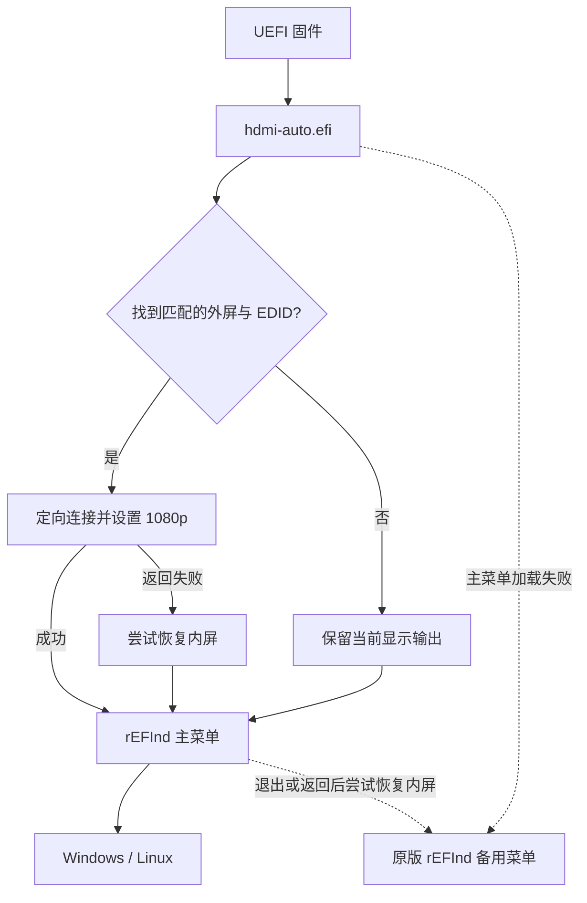

# rEFInd HDMI Boot

**让笔记本在进入操作系统之前，就能在 HDMI 外接显示器上显示 rEFInd 启动菜单。**

这是一次 Acer Nitro AN515-58 三系统引导改造中整理出的教程和源码：Windows 11、Windows 10 虚拟磁盘、Ubuntu 虚拟磁盘原本都能启动，但 rEFInd 只出现在内屏，外屏要等 Windows 进入锁屏才亮。最终通过 UEFI 程序指定外屏输出，再启动原版 rEFInd，解决了这台机器的问题。

> **已实测的是特定硬件配置，不是通用 HDMI 驱动。** 当前源码包含 AN515-58 实测设备路径；其他机器应先完成设备识别和独立测试，不要直接改成默认启动。编译不会安装程序、挂载 EFI 分区或修改 BIOS 启动设置。

## 实现效果

| 场景 | 实测结果 |
|---|---|
| HDMI 接好后开机 | 外屏显示 rEFInd，可选择系统并正常启动 |
| 关机、拔掉 HDMI、再开机 | 内屏显示菜单并正常启动 |
| UEFI 色块验证 | 1080p 蓝色、1440p 绿色、640×480 红色，各显示 15 秒 |
| 正常默认项 | 10 秒后进入 Windows 11 |
| 正常启动层数 | 一层 rEFInd；原入口另外保留作回退 |

实测环境：**Acer Nitro AN515-58 / BIOS V2.21 / RTX 4060 Laptop / 独显模式 / Secure Boot 关闭**。外屏 EDID 名称为 G52，原生分辨率 2560×1440；最终菜单选用已验证的 **1920×1080**。rEFInd 版本为 **0.14.2**。

其他显示器、混合显卡模式、USB-C/DP、扩展坞、Secure Boot 开启、BIOS 更新后的行为均未实机验证。

## 它为什么有效

排查中发现 NVIDIA UEFI 驱动已经存在，固件也识别到了外屏，但最初只为内屏提供活动图形输出。单纯改分辨率、切独显和执行通用 `connect -r` 都没有解决。

本程序使用实际设备路径，向固件已有的驱动发起定向 `ConnectController` 调用。外屏随后获得活动 EDID 和 GOP，程序选择 1080p，再通过 `LoadImage` / `StartImage` 加载原版 rEFInd。

这里没有重写 rEFInd、NVIDIA 显卡驱动，也没有刷 BIOS。UEFI 图形输出和 EDID 接口的定义可参考 [UEFI Console Support 规范](https://uefi.org/specs/UEFI/2.11/12_Protocols_Console_Support.html)。本机有效性则由实际日志与可见画面共同验证。



## 从哪里开始

1. **已有 rEFInd 能正常启动系统，只想解决外屏黑屏：**先阅读下面的构建方法，再按 [安装与恢复教程](docs/INSTALL.md) 进行独立测试。
2. **想了解整个排查过程：**阅读 [问题定位与实测记录](docs/DEBUGGING.md)。
3. **还没有做好三系统菜单：**先阅读 [三系统配置示例](docs/MULTIBOOT.md)。此项目不制作或分发 Windows/Linux 镜像。
4. **其他型号电脑：**先比对实际 GPU/显示输出路径，不能因为同样使用 NVIDIA 显卡就假定可以通用。

## 编译与主机模拟测试

需要 Windows x64、Visual Studio 2022 或 Build Tools 的 **Desktop development with C++** 工作负载，以及 Windows SDK。仓库已包含编译所需的 EDK II 头文件子集，无需完整搭建 EDK II 固件工程。

在 PowerShell 中运行：

```powershell
git clone https://github.com/oelene/refind-hdmi-boot.git
cd refind-hdmi-boot
powershell -NoProfile -ExecutionPolicy Bypass -File .\scripts\build.ps1
```

构建脚本通过 `vswhere` 查找 MSVC，自动选择已安装的 Windows SDK。安装位置特殊时可以显式提供：

```powershell
.\scripts\build.ps1 -VisualStudioPath 'D:\VS\BuildTools' -WindowsSdkRoot 'D:\WindowsKits\10'
```

需要同时构建独立菜单和色块测试时：

```powershell
powershell -NoProfile -ExecutionPolicy Bypass -File .\scripts\build.ps1 -Diagnostics
```

输出均位于 `build/`：

| 文件 | 用途 |
|---|---|
| `hdmi-auto.efi` | 最终自动入口，有外屏时尝试切换，没有则保留当前输出 |
| `hdmi-menu.efi` | 手动测试入口，验证切换之后能否运行真正的 rEFInd 菜单 |
| `target-output.efi` | 三色测试，测试结束后尝试恢复内屏 |
| `*.sha256` | 构建结果校验值 |
| `test-*.exe` | 在 Windows 上运行的模拟测试，不是 EFI 启动程序 |

构建会检查 x64 EFI Application 格式、无外部导入和重定位表，并运行 **25 个模拟场景：自动入口 11 个、菜单入口 8 个、诊断 6 个**。模拟测试覆盖代码分支，不能证明新机器的 HDMI 实际能出图。

本仓库为源码发布，不附带可直接安装的 EFI 二进制。公开构建使用与实测版本相同的运行时源码；构建脚本的工具链查找已改为可移植方式。每次重新构建产生的新文件仍需自行验证。

## 安装前必须理解的几个路径

程序当前约定的文件位置如下，均相对于 EFI 系统分区根目录：

```text
EFI/
├── gopdiag/
│   ├── hdmi-auto.efi        # 最终自动入口
│   └── hdmi-auto.txt        # 运行时追加的日志
├── refind-hdmi/
│   ├── refind_x64.efi      # 正常启动的原版 rEFInd
│   ├── refind.conf
│   └── icons/
└── refind/
    ├── refind_x64.efi      # 保留的原入口
    ├── refind.conf
    ├── icons/
    └── vdiskchain          # 仅在使用对应 Linux 虚拟磁盘方案时需要
```

`refind-hdmi` 没有绑定外屏；没接 HDMI 时它也用于内屏。保留两个 rEFInd 目录是当前回退设计，正常启动不会依次经过两个菜单。

目录名 `gopdiag` 来自最初诊断阶段，现在仍被自动程序用于写日志。修改目录名需要同步修改源码、菜单配置及固件入口。

完整的备份、三色测试、手动菜单、一次性启动验证、设为默认和恢复步骤见 **[INSTALL.md](docs/INSTALL.md)**。教程不会要求覆盖 Windows Boot Manager。

## 硬件匹配范围

当前内置的是以下实测路径，而不是某台显示器的序列号：

```text
GPU:      PciRoot(0x0)/Pci(0x1,0x0)/Pci(0x0,0x0)
Internal: GPU / AcpiAdr(0x80010400)
External: GPU / AcpiAdr(0x80010330)
```

这些路径在 `src/target-output.c` 的 `gpuPath`、`internalPath`、`externalPath` 中。`hdmi-auto.c` 复用 `hdmi-menu.c`，后者复用 `target-output.c` 的辅助函数；不要因为文件名包含测试含义就删除它们。

换同一 HDMI 接口上的显示器，不需要匹配 G52 型号，但需要固件能识别它并提供 1920×1080 模式。如果改了 `set1080()` 的模式策略，也要同步调整实际 `refind.conf` 中的 `resolution`，不能只改一处。

## 常见问题

**是不是 rEFInd 本身完全不能显示在外屏？**

不是。本机先选择正确的固件输出后，原版 rEFInd 可以正常显示在外屏。这个程序补上的是启动前的显示选择。

**是不是两层 rEFInd 嵌套？**

手动菜单测试阶段是两层；最终固件直接进入 `hdmi-auto.efi`，正常只有一层 rEFInd。备用菜单只在主菜单加载失败或返回等分支中使用。

**拔掉 HDMI 怎么办？**

没有匹配设备或有效外屏 EDID 时保留固件当前输出。本机已完成“关机拔线后开机”的实测；不是启动期间的热插拔测试。

**换一个 HDMI 显示器能用吗？**

程序没有绑定显示器型号。同接口、能提供 1080p 模式时有可能直接工作，但换屏未实测。USB-C、DP 或扩展坞不在当前验证范围。

**能保证黑屏时自动退回内屏吗？**

只能针对检查失败和固件返回错误等情况处理。若固件报告成功但外屏实际没有画面，程序无法通过肉眼判断。冷启动拔掉 HDMI 是本机已验证的恢复路径之一。

**Secure Boot 呢？**

本项目输出未签名，实测时 Secure Boot 关闭。签名、密钥注册和 Secure Boot 兼容性不在当前实现中。

**移动 VHD 会影响 HDMI 吗？**

显示选择与 VHD 文件位置是两件事。移动或改名会影响相应系统的 BCD 或 `vdisk=` 参数，通常不会直接破坏显示选择；请同步维护主、备用菜单。

**日志写不进去，会卡住启动吗？**

自动入口将日志视为可选项；日志打开失败仍会尝试启动菜单。磁盘或固件调用本身卡住不属于已经保证能恢复的情况。

## 仓库包含与不包含什么

包含原始实现源码、25 个模拟场景、可移植构建脚本、EDK II 头文件、中文教程和脱敏配置示例。

不包含个人磁盘 GUID、真实 BCD、原始 EDID、机器日志、EFI 备份、VHD/VHDX、Windows 启动器、rEFInd 二进制或专有显卡固件。示例中的 `<ESP_PARTITION_GUID>` 等占位符必须替换为自己的值。

原始代码与教程采用 [MIT License](LICENSE)。EDK II 头文件保留 BSD-2-Clause-Patent 许可及原版权声明，见 [第三方说明](THIRD_PARTY_NOTICES.md)。

## 上游项目

- [rEFInd](https://www.rodsbooks.com/refind/)：本项目继续使用的启动菜单。
- [TianoCore EDK II](https://github.com/tianocore/edk2)：UEFI 类型和协议头文件。
- [UEFI Specification](https://uefi.org/specifications)：协议定义。
- [vdiskchain](https://github.com/ventoy/vdiskchain)：可选的 Linux 虚拟磁盘链式加载器。
- [UEFI Shell 构建](https://github.com/pbatard/UEFI-Shell)：排查阶段可用的独立 Shell。

提交问题时请附上机器型号、BIOS 版本、显卡模式、连接接口及已脱敏的协议状态；不要上传完整 EFI 分区、系统镜像或含个人标识的原始日志。
